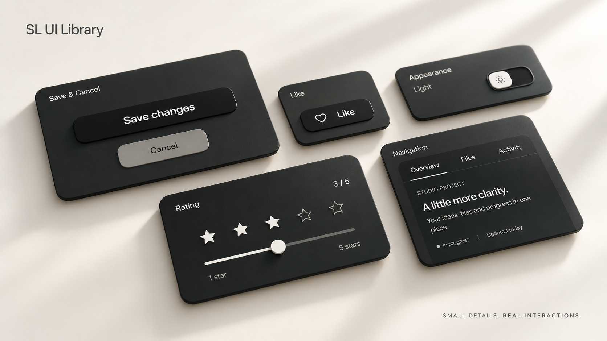
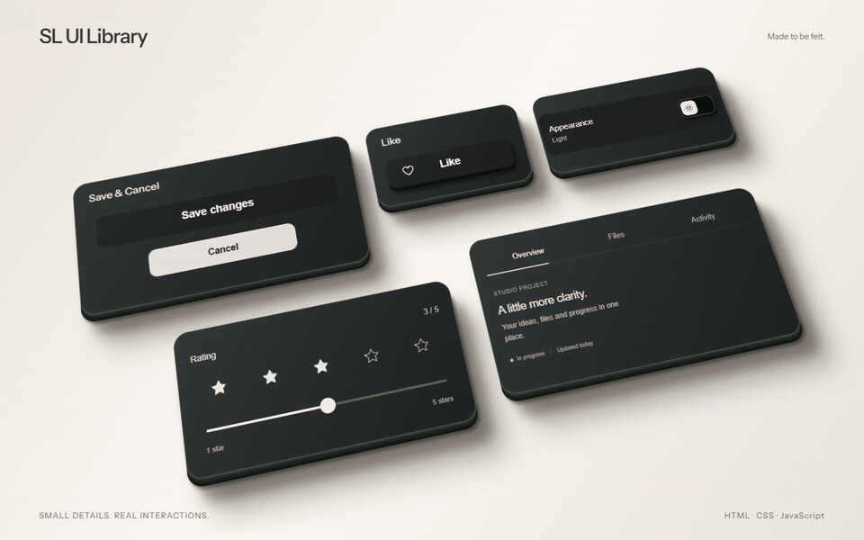
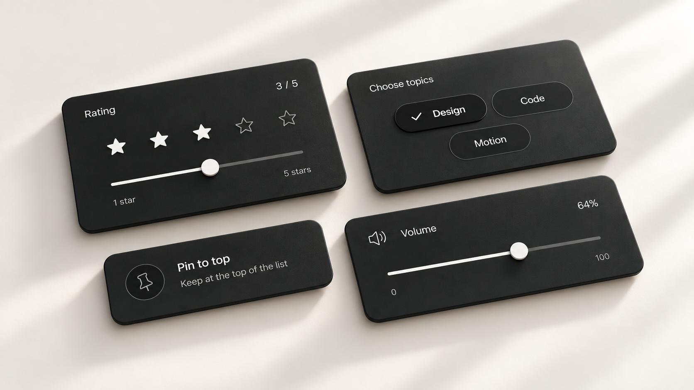

# SL UI Library

An AI plugin and interactive UI library with HTML, CSS, JavaScript, React and Next.js exports.

[English](README.md) · [Русский](README.ru.md)

**Version 1.2.3** adds optional website analytics and separately consented plugin activations. It retains all 388 components, palette-aware exports, Hermes Agent setup and the source-preserving framework adapters. [Release notes](docs/releases/v1.2.3.md) · [Framework integration](docs/frameworks.md) · [Previous release](docs/releases/v1.2.2.md).



**388 interactive components** with 390 export variants. Vanilla exports have no runtime dependencies, remote fonts or stock icon libraries. React and Next.js use your application's framework runtime and mount the same original controller as an isolated client widget. Preview components and download their complete source files.

[Open the library](https://sltowl.github.io/sl-ui-library/) · [Install the plugin](#plugin-installation) · [Components](#components) · [Integration guide](docs/integration.md) · [Quality notes](QA.md) · [MIT License](LICENSE)

## Component demos

[](https://sltowl.github.io/sl-ui-library/media/studio-motion.mp4)

The demo shows saving, liking, theme switching, rating and tab navigation. It uses the library's components with CSS 3D styling. No cursor.

[Watch / download MP4](https://sltowl.github.io/sl-ui-library/media/studio-motion.mp4) · [WebM](https://sltowl.github.io/sl-ui-library/media/studio-motion.webm) · [Live 3D scene](https://sltowl.github.io/sl-ui-library/studio-motion.html) · [Interactive showcase](https://sltowl.github.io/sl-ui-library/showcase.html)

Studio photography is generated artwork; the film uses library components with CSS 3D styling.

## Components

| Category | Components |
| --- | ---: |
| Buttons | 79 |
| Inputs | 51 |
| Toggles | 52 |
| Checkboxes | 36 |
| Sliders | 35 |
| Menus | 26 |
| Navigation | 24 |
| Overlays | 20 |
| Feedback | 23 |
| Data display | 42 |

388 components, 390 export variants. Save & Cancel is available together or separately. All ten categories contain working previews and complete source packages. Each package retains its original vanilla files and adds React / Next.js entry points with their documented companions.

## Plugin installation

Install directly from this GitHub repository. No official marketplace listing or library account is required.

### Claude Code

Paste this line into a terminal with Claude Code installed:

```sh
claude plugin marketplace add SLtowl/sl-ui-library && claude plugin install sl-ui-library@sl-ui-library
```

Inside a Claude Code chat, run the same setup as two slash commands:

```text
/plugin marketplace add SLtowl/sl-ui-library
/plugin install sl-ui-library@sl-ui-library
```

### Codex

Paste this line into a terminal with Codex installed:

```sh
codex plugin marketplace add SLtowl/sl-ui-library && codex plugin add sl-ui-library@sl-ui-library
```

These one-line commands work in macOS/Linux shells, Windows Command Prompt and PowerShell 7+. In Windows PowerShell 5, run the two commands separately; continue only if the first succeeds. They register the repository and install the plugin through the application's own plugin manager. They do not install the AI application or copy buttons into your projects.

Start a new task after installation. Then ask, for example:

> Add a like button from SL UI Library. Use a violet background and light text, and keep its animation and keyboard interaction.

The agent selects a component, reads its original source and the instructions for your chosen format, then exports the complete package with the requested palette. HTML, CSS, JavaScript, React and Next.js files are bundled for every variant. The complete catalog and source files work offline after installation; the AI host has its own connectivity requirements. The bundled source CLI requires Node.js 22+.

### Hermes Agent

Connect the existing `use-sl-ui` skill through Hermes's external skill directories. Requires Hermes Agent, Git and Node.js 22+ on the machine where the agent runs.

Clone this repository into a permanent location:

```sh
git clone https://github.com/SLtowl/sl-ui-library.git
```

In the active Hermes profile's `config.yaml` (`~/.hermes/config.yaml` for the default profile), add the clone's skill directory:

```yaml
skills:
  external_dirs:
    - /absolute/path/to/sl-ui-library/plugins/sl-ui-library/skills
```

Replace the example with your actual absolute path. On Windows, use forward slashes, for example `C:/Tools/sl-ui-library/plugins/sl-ui-library/skills`. Merge this into an existing `skills` section and retain any other directories.

Restart Hermes, then enter `/use-sl-ui` in a new conversation and describe your interface task. Keep the complete clone: the skill resolves its source tools and offline assets relative to its own directory. Copying only `SKILL.md` is not a complete installation. This connects a skill; no Hermes plugin-catalog listing is required.

[Official Hermes external skill directories](https://hermes-agent.nousresearch.com/docs/user-guide/features/skills#external-skill-directories) · [Detailed setup](docs/agents.md#hermes-agent)

### Claude and ChatGPT without a terminal

**Claude:** [download the plugin ZIP](https://sltowl.github.io/sl-ui-library/downloads/sl-ui-library-plugin.zip) and use **Customize → Plugins** to upload a custom plugin, where supported.

**ChatGPT web:** the terminal commands above do not install into an ordinary chat. A public ChatGPT Install link is not available yet; official directory publication is planned separately. Codex installation works without that publication.

[Platform setup, supported clients and updates](docs/agents.md) · [Claude Code plugin documentation](https://code.claude.com/docs/en/discover-plugins) · [OpenAI plugin documentation](https://developers.openai.com/plugins/build/plugins)

<details>
<summary>Only need one component?</summary>

From a downloaded repository:

```sh
node component.mjs like ./my-button
```

This exports one complete example to a new folder. Its parent must exist; existing destinations and symlink parents are refused. Source files are verified before writing.

</details>

## Updating the plugin

For an existing GitHub marketplace installation, run the commands below one at a
time in a terminal. Continue only if the first command succeeds.

**Codex:**

```sh
codex plugin marketplace upgrade sl-ui-library
codex plugin add sl-ui-library@sl-ui-library
```

**Claude Code:**

```sh
claude plugin marketplace update sl-ui-library
claude plugin update sl-ui-library@sl-ui-library
```

If Claude Code was installed at project or local scope, use the matching
`--scope project` or `--scope local` on the plugin update command. Start a new
session after updating. For an uploaded ZIP installation, download the current
[plugin ZIP](https://sltowl.github.io/sl-ui-library/downloads/sl-ui-library-plugin.zip)
and replace it through the host's plugin manager.

### Versions and update checks

**Hermes Agent:** review upstream changes, then run `git -C "/absolute/path/to/sl-ui-library" pull --ff-only` against the clone connected above and restart Hermes. Use your actual clone path. This updates the connected library, not components already exported into your applications.

The repository package, portable manifest, Claude/Codex manifests and bundled
catalog share the same version. Every published plugin-code change must increment
the version; a GitHub push alone is not sufficient for version-aware caches.
Version 1.2.2 refreshes the reviewed component sources and catalogue website.
Version 1.2.1 clarified framework-format descriptions for version-aware clients.
The earlier 1.1.2 release introduced the stricter source gate.

[Claude Code version detection](https://code.claude.com/docs/en/plugin-marketplaces#version-resolution-and-release-channels)
· [Codex marketplace commands](https://developers.openai.com/plugins/build/plugins).

The source audit compares `sl-*` classes and inline SVG geometry in serialized
component HTML. It flags missing or changed source markers, not arbitrary CSS or
animation defects. It is an explicit offline check, not a background monitor or
automatic repair. See the [audit guide](plugins/sl-ui-library/scripts/integration-guide.md).
The CLI exits nonzero when it reports `needs-review`; agents must not claim an SL UI
integration without a returned component ID, variant, source hashes and a passing audit.
Updating the plugin never rewrites components already copied into another app.

### Catalog updates

An opt-in data updater is prepared for the release channel. Once published and enabled by the user, it checks for a newer catalog on use, at most once per day, with an offline fallback. Existing components in your app are never silently replaced. Plugin code and skill updates remain host-managed.

**Update status:** the public data-update channel is not live. Optional analytics is separate: website collection starts only after Allow analytics; the plugin can send one activation only after explicit consent. No ongoing plugin usage is collected. Downloads and consenting activations are not verified installations. See [analytics and privacy](docs/agents.md#download-reporting-and-privacy).

## Component integration

Each component archive includes HTML, CSS, JavaScript, React and Next.js exports, integration examples and local assets. Its Usage notes describe how to add it to your project and connect action handlers.

### Choose an export format

| Format | Entry files | Integration |
| --- | --- | --- |
| HTML, CSS and JavaScript | `index.html`, `buttons.css`, `buttons.js`, `example.js` and any local modules | Use the original controller and connect your application actions. |
| React | `Component.jsx` and `react-example.jsx` | Import the source-preserving adapter and own callbacks in your application. |
| Next.js | `NextClient.jsx` and `next-page.jsx` | Use the Client Component boundary and the callback-owning example. |

Download the complete ZIP. React and Next.js entries depend on `react-controller.mjs`, `react-font.mjs`, the bundled font and any documented supporting resources; copying one JSX file is not a complete integration. The examples and `framework-usage.md` describe props, refs and lifecycle behavior.

React and Next.js exports are isolated client-widget adapters over the original controllers, not native React-state rewrites. Initial server output is a stable placeholder, not meaningful widget SSR. Keep host form ownership, callbacks, CSP and accessibility integration in mind. See the [framework guide](docs/frameworks.md) for the complete contract.

Archive, rename and creation demos only change preview state. In production, show success after your own operation succeeds. User-entered names remain literal text, including Unicode; action labels stay English.

## Library website

This repository contains the complete static library. GitHub stores the source; GitHub Pages serves the public website. Visitors to a hosted version will not need terminal commands or Node.js.

The site is published from `public/` by the [Pages workflow](https://github.com/SLtowl/sl-ui-library/actions/workflows/pages.yml). Check its latest deployment before sharing the website; a failed run means the site has not been updated.

<details>
<summary>For developers: run a local copy</summary>

Requires Node.js 22 or newer. From the repository:

```sh
npm start
```

This builds the exports and starts a local server. Open `http://127.0.0.1:4321/` on the same computer. No dependency installation is required. Use HTTP, not a double-clicked HTML file.

</details>

## Repository structure

```text
public/                 Interactive site and component source
  packages/             Self-contained component examples
plugins/sl-ui-library/  Portable plugin, host manifests, skill and source tools
docs/                   Guides, studio photography and film
tests/                  Automated checks
install.mjs             Optional Codex CLI installer
component.mjs           Optional single-component export
```

Edit component sources in `public/packages/` and metadata in `public/catalog-data.js`, then run `npm run build` and `npm run check`. Commit source and tracked generated data together. ZIP exports are regenerated by build/start rather than duplicated in Git history. See [contributing](CONTRIBUTING.md).

## Checks and limitations

- Project-owned SVG icons and bundled fonts.
- Keyboard interaction, visible focus and reduced-motion support.
- Repeated interaction and reset checks.
- Source, ZIP export and agent bundle consistency checks.
- No tracking in exported components. Optional site analytics and plugin activation reporting require consent; no session recordings, source code or input text.

See [QA evidence and limitations](QA.md). The 1.2.0 framework release was checked in Chromium-based Microsoft Edge; Firefox, Safari and physical touch devices still need a separate release check.



Cover and closing image: generated studio artwork from the first release. Film: actual controls with a 3D presentation layer. [Media provenance](docs/media.md).

## Release status

[SLtowl/sl-ui-library](https://github.com/SLtowl/sl-ui-library) is public. The plugin archive and Claude Code repository marketplace are available. A public ChatGPT Plugins Directory listing has not been submitted or approved. Version 1.2.3 adds optional analytics with separate website and plugin consent. Component source and interaction behavior are unchanged.

## License

The library and agent plugin are licensed under the [MIT License](LICENSE). You can use, modify and redistribute the code, including in commercial projects, provided you retain the copyright and license notices.

The bundled Instrument Sans font is licensed separately under the SIL Open Font License 1.1. Its [OFL notice](public/packages/like/OFL.txt) remains included with component downloads.

The website also bundles Plus Jakarta Sans and Manrope under their respective [Plus Jakarta Sans OFL notice](public/experiments/library-shell/plus-jakarta-sans-OFL.txt) and [Manrope OFL notice](public/experiments/library-shell/manrope-OFL.txt).
